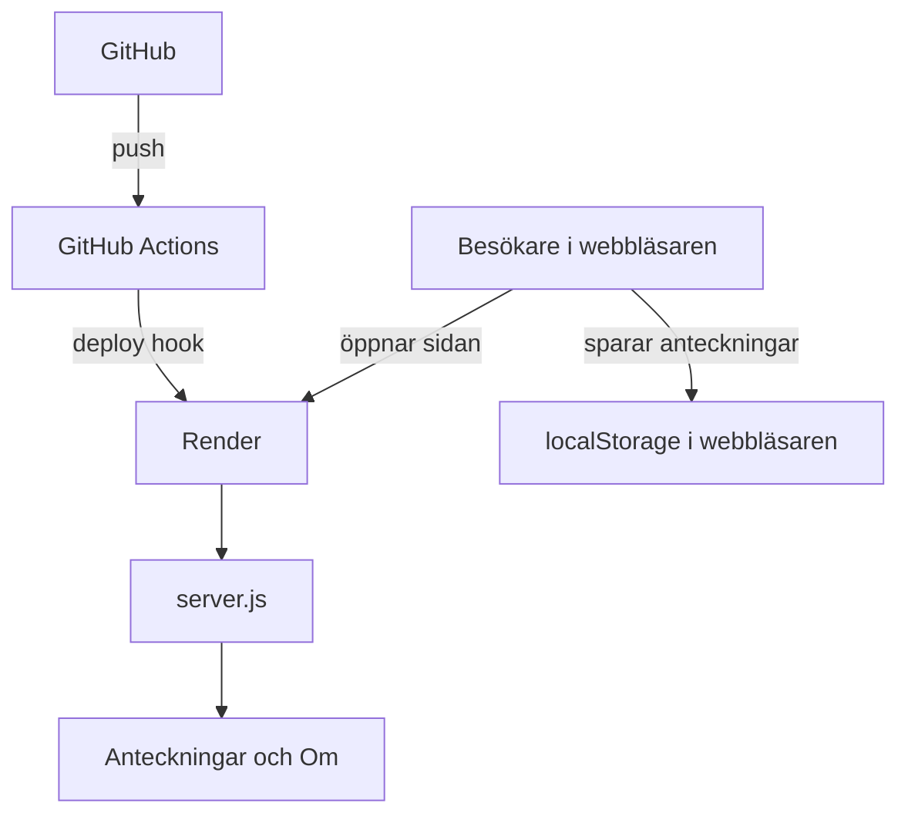

Individuell inlämningsuppgift – CI/CD, Docker och molndrift med Render

# Notepad

Notepad är en liten webbapplikation där man kan skriva anteckningar.
De två sidorna är:

- Anteckningar, där man skriver, sparar, redigerar och tar bort sina anteckningar.
- Om, där man ser vad appen heter, vilken miljö den körs i (development lokalt och production på render) och maxlängd på en anteckning.

Anteckningarna sparas i webbläsarens localStorage. Det finns ingen databas, så varje webbläsare har sina egna anteckningar.

## Teknik

Jag har byggt webbapplikationen med React och Vite. Vite visar appen på http://localhost:5173 när jag kör den lokalt på min dator.
Filen server.js är en egen server byggd med Express. Den läser miljövariablerna, svarar på /health och skriver loggarna.
Jag valde Vite och en egen server för att det kändes enklast och mer tydligt.

## För att köra lokalt

Installera dependencies
npm install

Kopiera .env.example och lägg in i en .env-fil.

Starta servern i en terminal:
node --env-file=.env server.js

Servern lyssnar på port 3000. Där finns /health och /config.

Starta Vite i en separat terminal:
npm run dev

Öppna sedan http://localhost:5173.

## Docker

För att bygga imagen:
docker build -t notepad .

Starta en container.
docker run --rm -p 3000:3000 -e PORT=3000 -e APP_NAME=Notepad -e APP_ENV=production -e MAX_NOTE_LENGTH=2000 notepad

Öppna http://127.0.0.1:3000

## Miljövariabler

Miljövariabler är värden som servern läser när den startar. Samma kod kan då visa olika saker beroende på vart projektet körs.

Lokalt ligger värden i .env och den filen är med i .gitignore och pushas därför inte till Github. Däremot så pushas .env.example. Där ser man vilka namn som behövs, så att man kan skapa en egen .env.
På Render satte jag samma värden genom settings, men APP_ENV är production. PORT sätter Render själv.
Dessa värden är inte hemliga. Hemligheten är adressen som startar en ny deploy på Render. Den heter RENDER_DEPLOY_HOOK_URL och finns bara som en secret i Github Actions.

## Loggar och health

server.js skriver loggar när något händer.

När servern startar skrivs `INFO: Server started on port ...`.
Ett anrop till `/health` skriver `INFO: Health check ok` och svarar med `{ "status": "ok" }`.
Ett anrop till `/config` skriver `INFO: Config requested`.
Ett anrop till en okänd adress under `/api`, till exempel `/api/not-found`, skriver `ERROR: Unknown API route ...` och svarar med 404.

Render anropar `/health` med jämna mellanrum. Svarar den med status 200 är servern igång. Loggarna syns under Logs på Render.

## Github Actions

.github/workflow/deploy.yml körs när jag pushar till master.

Detta är vad den gör i ordning:

- Hämtar koden
- Installerar Node 22
- Kör npm ci
- Kör npm run build
- Kör docker build -t notepad .
- Och om alla dessa steg lyckas så skickar den ett anrop till RENDER_DEPLOY_HOOK_URL

Det anropet ber Render att hämta koden och bygga tjänsten på nytt. Den imagen som Github Actions bygger laddas inte upp någonstans utan Render bygger sin egen image från Dockerfile. Misslyckas någon innan sista anropet så startas inte en ny deploy. Det är alltså bara det sista kommandot som pratar med Render.

## Render

Appen kör på Render som en Docker Web Service.
Adressen är https://notepad-9v1u.onrender.com.

Miljövariabler på Render:
APP_NAME=Notepad
APP_ENV=production
MAX_NOTE_LENGTH=2000
NODE_ENV=production

Som nämnts tidigare så sätter Render PORT själv.
En ny deploy startar när GitHub Actions anropar deploy-hooken. Render hämtar då den senaste koden och bygger om tjänsten. En push till GitHub startar inte en deploy av sig själv.

## Kostnad

Vilken Render-plan använder du?

Free. Den som är gratis.

Varför har du valt den?

För att jag är student och har lite ont om cash at the moment. Utöver det så är appen liten. Den har ingen tillhörande databas, utan datan sparas i webbläsaren med localStorage.

Vilka faktorer påverkar kostnaden?

Render har olika planer. Beroende på hur många timmar tjänsten är vaken, hur mycket minne och CPU planen har, och om man lägger till fler tjänster eller en databas.

Hur kan du minska resursanvändningen?

Genom att göra det vi gjort i den här uppgiften bland annat. Behålla en liten tjänst och låta den somna när den inte används. Anteckningarna ligger i webbläsaren.

Vilka begränsningar har den nuvarande lösningen?

Tjänsten somnar efter ungefär 15 minuter. Den har 512 MB minne och 0,1 CPU. Det finns 750 vakna timmar per månad. Disken är tillfällig, så filer på servern försvinner vid omstart. Varje webbläsare har sin egen lista.

Vad skulle du behöva förändra med betydligt fler användare?

En betald plan som är igång hela tiden, så att sidan inte somnar. Om anteckningarna ska delas mellan användare behövs en databas. localStorage räcker inte då.

## Arkitektur

